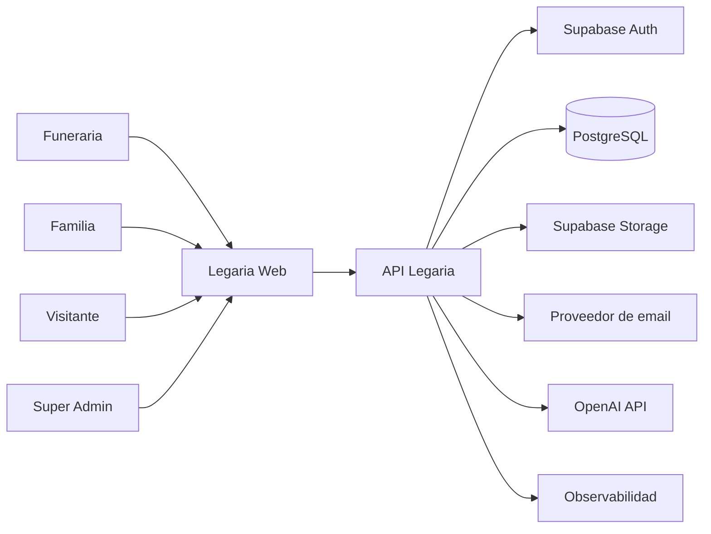
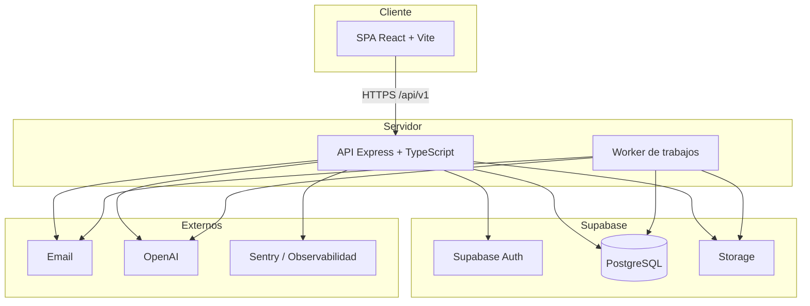
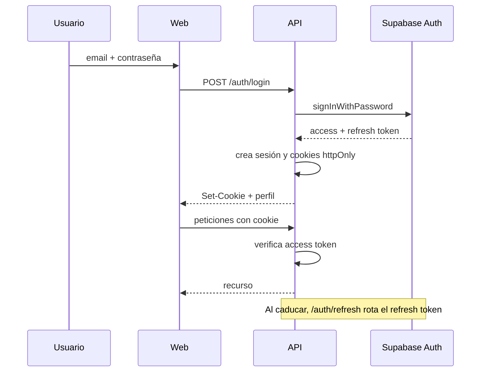
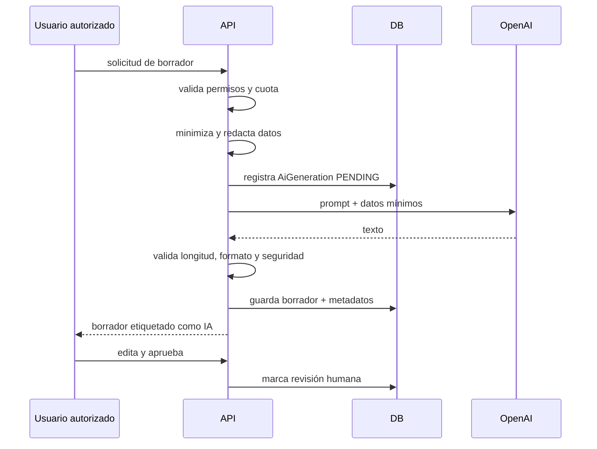

# Arquitectura — Legaria

**Estado:** Propuesta para validación  
**Versión:** 0.1

---

## 1. Principios

1. **Monolito modular:** un solo despliegue de API, con módulos separados por dominio y dependencias explícitas. Sin microservicios en la primera versión.
2. **Contratos compartidos:** Zod como fuente de verdad para validación, tipos y documentación OpenAPI.
3. **Seguridad en profundidad:** autenticación, autorización por contexto, aislamiento multi-tenant, validación, auditoría y mínimo privilegio.
4. **Privacidad desde el diseño:** minimización, buckets privados, URLs firmadas, retención y eliminación.
5. **Simplicidad operativa:** PostgreSQL como pieza central; evitar infraestructura innecesaria.
6. **Evolución:** preparar puntos de extensión para IA, suscripciones e internacionalización sin implementarlos todavía.

---

## 2. Contexto del sistema



### Actores

- **Funeraria:** organización cliente del SaaS.
- **Familia:** usuarios invitados por la funeraria o por otros familiares.
- **Visitante:** acceso anónimo a memoriales públicos.
- **Super Admin:** administración de la plataforma.

### Sistemas externos

- Supabase Auth.
- PostgreSQL gestionado por Supabase.
- Supabase Storage.
- Proveedor de email transaccional.
- OpenAI API.
- Herramienta de errores y métricas.

---

## 3. Contenedores



### Decisiones de contenedores

- **Un solo backend** con módulos. Los trabajos en segundo plano se ejecutan en un worker separado usando el mismo código.
- **Sin acceso directo del navegador a la base de datos.** El frontend solo habla con la API.
- **Supabase Auth** gestiona credenciales y sesiones. La API verifica la identidad y resuelve roles y contextos desde PostgreSQL.
- **Storage** se usa con buckets privados. La API autoriza y genera URLs firmadas.
- **OpenAI** solo se invoca desde el backend.

---

## 4. Arquitectura del backend

### 4.1. Capas por módulo

```text
modules/<dominio>/
├── <dominio>.routes.ts       # Definición de rutas y middlewares
├── <dominio>.controller.ts   # Traducción HTTP <-> servicio
├── <dominio>.service.ts      # Reglas de negocio y autorización de recurso
├── <dominio>.repository.ts   # Consultas Prisma acotadas por tenant
├── <dominio>.mapper.ts       # Entidad <-> DTO
├── <dominio>.types.ts        # Tipos internos
└── <dominio>.test.ts         # Pruebas del módulo
```

Reglas:

- El controlador no contiene reglas de negocio.
- El servicio recibe un `ActorContext` y aplica permisos de recurso.
- El repositorio **siempre** recibe el ámbito de organización o familia y nunca permite consultas globales accidentales.
- Los contratos de entrada y salida viven en `packages/contracts` cuando se comparten con el frontend.
- Las transacciones se gestionan en el servicio, no en el controlador.

### 4.2. Módulos

| Módulo | Responsabilidad |
|---|---|
| `auth` | Login, refresh, logout, recuperación, sesión y verificación de identidad. |
| `users` | Perfil, estado de cuenta y preferencias. |
| `organizations` | Organizaciones, miembros, roles y configuración. |
| `employees` | Invitaciones y gestión de empleados. |
| `cases` | Expedientes, estados y asignaciones. |
| `deceased-persons` | Datos de la persona fallecida. |
| `funeral-services` | Servicios, salas y ceremonias. |
| `families` | Grupos familiares y miembros. |
| `invitations` | Creación, canje y revocación de invitaciones. |
| `memorials` | Memorial, biografía, visibilidad y publicación. |
| `condolences` | Condolencias y moderación. |
| `memories` | Recuerdos y cronología. |
| `media` | Subida, validación, procesamiento y URLs firmadas. |
| `ai` | Generaciones, prompts, cuotas y revisión. |
| `notifications` | Emails y avisos. |
| `subscriptions` | Planes y estado de suscripción (fase 7). |
| `audit` | Registro de operaciones sensibles. |
| `admin` | Panel global, métricas y acceso de soporte. |

### 4.3. Shared

```text
shared/
├── auth/            # ActorContext, verificación de JWT, sesión
├── authorization/   # Permisos, políticas, guards
├── db/              # Cliente Prisma, transacciones, paginación
├── errors/          # Errores de dominio y mapeo HTTP
├── http/            # Middlewares, requestId, validación
├── audit/           # Servicio de auditoría
├── storage/         # Adaptador de Supabase Storage
├── email/           # Adaptador de email
├── ai/              # Interfaz AiProvider
└── utils/           # Fechas, slugs, tokens, criptografía
```

### 4.4. Ciclo de una petición

```text
Request
  -> requestId + logger
  -> seguridad (helmet, CORS, rate limit)
  -> autenticación (JWT / sesión)
  -> resolución de actor (usuario + memberships)
  -> validación de entrada (Zod)
  -> autorización de rol/permiso
  -> controlador
  -> servicio (reglas + autorización de recurso + transacción)
  -> repositorio (Prisma acotado)
  -> auditoría si procede
  -> respuesta DTO
  -> error handler centralizado
```

### 4.5. Contexto del actor

```ts
type ActorContext = {
  userId: string;
  authUserId: string;
  platformRoles: PlatformRole[];
  organizationMemberships: Array<{
    organizationId: string;
    role: OrganizationRole;
    status: "ACTIVE";
  }>;
  familyMemberships: Array<{
    familyGroupId: string;
    caseId: string;
    role: FamilyRole;
    status: "ACTIVE";
  }>;
};
```

- Los roles **no** se confían al JWT de Supabase. Se resuelven desde PostgreSQL.
- Se pueden cachear durante pocos segundos, pero deben invalidarse al cambiar permisos.
- Toda operación de tenant recibe el `organizationId` de la ruta y lo contrasta con las memberships.
- Toda operación familiar recibe el `familyGroupId` o el recurso y contrasta la membership.

---

## 5. Autenticación y sesión

### 5.1. Flujo recomendado (BFF con cookies)



Ventajas:

- El refresh token no queda accesible a JavaScript.
- Permite revocación centralizada.
- Facilita CSRF con `SameSite=Lax` y token anti-CSRF.
- Encaja con una API y un frontend en el mismo dominio registrable (`app.legaria.es` y `api.legaria.es`).

Requisitos:

- Cookies `httpOnly`, `Secure`, `SameSite=Lax`.
- Token anti-CSRF para métodos mutables.
- Rotación de refresh token y detección de reutilización.
- Reautenticación para acciones sensibles.
- CORS con credenciales y lista de orígenes permitidos.

> Alternativa si se opta por SPA con Bearer: access token en memoria y refresh gestionado por Supabase JS. Es más simple, pero expone más superficie ante XSS. La decisión está en `docs/05-decisiones-pendientes.md`.

### 5.2. Sesiones

- Access token de corta duración.
- Refresh token rotatorio.
- Sesión absoluta máxima configurable.
- Revocación por usuario, organización o sesión.
- Logout local y global.
- MFA para administradores.

---

## 6. Autorización

### 6.1. Modelo

Se combinan:

- **RBAC:** permisos por rol.
- **Contexto:** organización, expediente, grupo familiar y recurso.
- **Estado:** membresía activa, organización activa, expediente no archivado, memorial en estado permitido.
- **Propiedad:** quién creó el recurso, quién está asignado, quién es administrador familiar.

### 6.2. Regla de oro

> Ningún endpoint que reciba un identificador de recurso puede consultarlo sin aplicar simultáneamente el ámbito del actor.

Ejemplo:

```ts
const memorial = await memorialRepository.findByIdForActor({
  memorialId,
  actor,
});
```

Nunca:

```ts
const memorial = await prisma.memorial.findUnique({ where: { id } });
```

### 6.3. Permisos

El catálogo y la matriz están en [specs/01-autenticacion-rbac.md](../specs/01-autenticacion-rbac.md).

### 6.4. Super Admin

`SUPER_ADMIN` administra la plataforma, pero **no accede al contenido sensible por defecto**.

Para acceder a expedientes, personas fallecidas, documentos o memoriales de una organización se requiere un **acceso de soporte**:

- Motivo obligatorio.
- Ámbito limitado.
- Duración máxima.
- Registro de auditoría.
- Revocación inmediata.
- Notificación interna.

---

## 7. Multi-tenancy

### 7.1. Estrategia

**Base de datos compartida, esquema compartido y `organization_id` en todas las tablas de tenant.**

Motivos:

- Simplicidad operativa.
- Coste bajo.
- Migraciones únicas.
- Suficiente para el volumen previsto.
- Facilita analítica agregada.

### 7.2. Defensas

1. **Aplicación:** repositorios acotados por organización; servicios con autorización de recurso.
2. **Base de datos:** claves foráneas compuestas `(id, organization_id)` para evitar referencias cruzadas.
3. **Pruebas:** cada endpoint con datos de dos organizaciones y verificación de aislamiento.
4. **RLS (opcional, defensa en profundidad):** políticas de PostgreSQL para acceso directo o herramientas internas. Prisma con rol de servicio no queda cubierto por RLS, por lo que la aplicación sigue siendo la defensa principal.

### 7.3. Familias

Los datos familiares se acotan por `family_group_id` y por el expediente asociado. Un familiar no obtiene acceso global a la organización.

---

## 8. Base de datos y Prisma

- PostgreSQL 15+ gestionado por Supabase.
- Prisma como ORM y herramienta de migraciones.
- UUID como identificador principal.
- `created_at`, `updated_at` y `deleted_at` cuando aplique.
- Enums de PostgreSQL para estados cerrados.
- Índices en claves foráneas, campos de búsqueda y filtros frecuentes.
- Migraciones versionadas y revisadas en CI.
- Seed de desarrollo con dos organizaciones para probar aislamiento.

### Conexión

- **Runtime:** connection pooler de Supabase (puerto de pooling).
- **Migraciones:** conexión directa.
- Variables separadas: `DATABASE_URL` y `DIRECT_URL`.
- Límite de conexiones ajustado al plan.

### Transacciones

- Operaciones que afectan a varias tablas usan transacción.
- La auditoría crítica se escribe en la misma transacción cuando sea posible.
- Nunca se mantienen transacciones abiertas durante llamadas a OpenAI o email.

---

## 9. Almacenamiento y medios

### Buckets

| Bucket | Privacidad | Uso |
|---|---|---|
| `case-documents` | Privado | Documentación del expediente. |
| `authorization-documents` | Privado restringido | Autorizaciones de publicación. |
| `memorial-originals` | Privado | Originales de fotografías y vídeos. |
| `memorial-public` | Público controlado | Derivados optimizados de memoriales públicos. |
| `avatars` | Privado | Fotografías de perfil. |

### Reglas

- Originales siempre privados.
- Derivados públicos solo para memoriales `PUBLISHED` + `PUBLIC`.
- URLs firmadas de corta duración para contenido privado.
- Validación de MIME real, extensión y tamaño.
- Imágenes procesadas con `sharp`: redimensionado, conversión y eliminación de EXIF.
- SVG no permitido.
- Nombres de archivo generados; nunca se confía en el nombre original.
- Límites por tipo: imagen, vídeo y documento.
- Antivirus/malware opcional en fase posterior.
- Descarga con `Content-Disposition` y `X-Content-Type-Options: nosniff`.

### Estructura de rutas

```text
organizations/{organizationId}/cases/{caseId}/documents/{documentId}
memorials/{memorialId}/originals/{mediaId}
memorials/{memorialId}/public/{mediaId}
```

Las políticas de Storage se basan en estas rutas como defensa adicional.

---

## 10. Inteligencia artificial

### 10.1. Principios

- Solo backend.
- Proveedor abstracto mediante interfaz.
- No publicación automática.
- No invención de datos.
- No simulación de la persona fallecida.
- Minimización y redacción previa.
- Registro de generaciones.
- Cuotas por organización y usuario.
- Revisión humana obligatoria.

### 10.2. Flujo



### 10.3. Abstracción

```ts
interface AiProvider {
  generate(input: AiGenerationInput): Promise<AiGenerationResult>;
}
```

Permite cambiar de proveedor sin tocar los módulos de negocio.

---

## 11. Trabajos en segundo plano

| Trabajo | Frecuencia |
|---|---|
| Envío de emails | Inmediato / reintentos. |
| Procesamiento de imágenes | Al subir. |
| Limpieza de invitaciones caducadas | Diaria. |
| Eliminación de datos solicitada | Programada. |
| Recordatorios de aniversarios | Diaria (fase 6). |
| Reintentos de generaciones fallidas | Bajo demanda. |
| Copias de seguridad y verificación | Según proveedor. |

Recomendación: `pg-boss` sobre PostgreSQL para el MVP, evitando Redis. Si el volumen o la latencia lo requieren, migrar a una cola dedicada.

---

## 12. Observabilidad

- Logs JSON con `requestId`, ruta, método, estado y duración.
- Nunca loguear cuerpos con datos personales, biografías, condolencias o tokens.
- Sentry (o equivalente) con scrubbing de PII.
- Métricas: latencia, errores, conexiones, uso de IA y coste.
- Alertas: errores 5xx, fallos de migración, picos de 401/403, consumo anómalo de IA.
- Health checks: `/health` y `/ready`.

---

## 13. Despliegue

### Entornos

| Entorno | Uso |
|---|---|
| Local | Desarrollo con Supabase local o Docker y datos de prueba. |
| Staging | Validación previa a producción, datos sintéticos. |
| Producción | Datos reales, acceso restringido y auditoría. |

### Propuesta

- **Web:** Vercel o Cloudflare Pages.
- **API:** Render, Fly.io o Railway.
- **Datos, auth y storage:** Supabase en región europea.
- **Dominios:** `app.legaria.es` y `api.legaria.es` para mantener cookies same-site.
- **CI/CD:** GitHub Actions con lint, typecheck, tests, build y migraciones controladas.

> La decisión de hosting está pendiente de validación.

---

## 14. Pruebas

| Tipo | Herramienta | Alcance |
|---|---|---|
| Unitarias | Vitest | Servicios, políticas, utilidades. |
| Integración API | Vitest + Supertest + PostgreSQL | Endpoints, autorización, transacciones. |
| Aislamiento | Vitest | Dos organizaciones, acceso cruzado. |
| E2E | Playwright | Invitación, expediente, memorial, condolencia. |
| Accesibilidad | axe-core + Playwright | Flujos críticos. |
| Seguridad | npm audit, CodeQL/Semgrep, ZAP baseline | Dependencias y OWASP. |
| Contratos | Zod + OpenAPI | Validación de esquemas y documentación. |

### Cobertura mínima

- 100 % de endpoints con prueba de autenticación.
- 100 % de endpoints con recurso de tenant con prueba de aislamiento.
- Flujos críticos E2E estables.

---

## 15. Riesgos arquitectónicos

| Riesgo | Mitigación |
|---|---|
| Fugas entre tenants | Repositorios acotados, claves compuestas, pruebas. |
| Complejidad del BFF de sesión | Documentar flujo, tests de refresh/revocación. |
| Acoplamiento a Supabase | Adaptadores y migraciones estándar de PostgreSQL. |
| Coste de IA | Cuotas, caché de prompts, límites por plan. |
| Medios pesados | Límites, procesamiento y almacenamiento separado. |
| Crecimiento del monolito | Módulos con límites claros y dependencias explícitas. |
