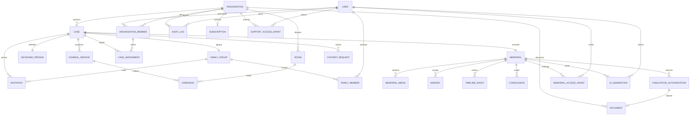

# Modelo de datos inicial — Legaria

**Estado:** Propuesta para validación  
> **Fuente de verdad**: `apps/api/prisma/schema.prisma`. Este documento es un resumen ejecutivo del modelo. Si hay discrepancia entre este documento y el schema de Prisma, el schema prevalece y este documento debe actualizarse.

> **RLS**: las políticas RLS aplicadas a este modelo están documentadas en ADR 0006 y ADR 0007, y viven en `infra/db/policies/`.
**Motor:** PostgreSQL 15+ / Prisma ORM  
**Identificadores:** UUID

---

## 1. Convenciones

- Tablas en `snake_case`; modelos Prisma en `PascalCase`; JSON en `camelCase`.
- Fechas en `timestamptz` y UTC.
- UUID generado en base de datos con `gen_random_uuid()`.
- `created_at` y `updated_at` en todas las entidades mutables.
- `deleted_at` para borrado lógico cuando la recuperación o la auditoría lo requieran.
- Enums de PostgreSQL para estados cerrados.
- `jsonb` solo para configuración o metadatos flexibles, nunca para campos centrales.
- Todas las tablas de tenant incluyen `organization_id`, aunque sea redundante con una relación padre.
- No se almacena DNI/NIE de la persona fallecida en el MVP salvo necesidad justificada.
- Los secretos y tokens nunca se guardan en claro.

> Además de las entidades iniciales del PRD, se añaden `rooms`, `ceremonies`, `case_assignments`, `documents`, `support_access_grants`, `content_requests`, `publication_authorizations` y `memorial_access_grants` para cubrir requisitos funcionales y de control de acceso.

---

## 2. Diagrama entidad-relación



---

## 3. Entidades

### 3.1. Identidad y tenancy

#### `users`

Usuario de la plataforma. No almacena credenciales: **Better Auth** es la fuente de identidad.

| Campo | Tipo | Notas |
|---|---|---|
| `id` | uuid PK | Identificador interno. |
| `auth_user_id` | text unique | Referencia a `auth_user.id` de Better Auth. |
| `email` | citext unique | Normalizado. |
| `full_name` | text | Nombre visible. |
| `phone` | text null | Opcional. |
| `locale` | text | `es-ES` por defecto. |
| `status` | enum | `PENDING`, `ACTIVE`, `SUSPENDED`, `DELETED`. |
| `last_login_at` | timestamptz null | Último acceso. |
| `created_at`, `updated_at` | timestamptz | |
| `deleted_at` | timestamptz null | Borrado lógico. |

#### Tablas de Better Auth

Better Auth gestiona la identidad en cuatro tablas propias. Se mapean a modelos Prisma con nombres distintos para no colisionar con `User`:

| Tabla | Modelo Prisma | Contenido |
|---|---|---|
| `auth_user` | `AuthUser` | Identidad, email verificado e imagen. |
| `auth_session` | `AuthSession` | Sesiones, token, caducidad, IP y user agent. |
| `auth_account` | `AuthAccount` | Proveedores, hash de contraseña y tokens OAuth. |
| `auth_verification` | `AuthVerification` | Verificaciones de email y recuperación. |

`users.auth_user_id` enlaza el perfil de dominio con `auth_user.id`. Las credenciales y los tokens **nunca** se copian a `users`.

#### `organizations`

Funeraria cliente del SaaS.

| Campo | Tipo | Notas |
|---|---|---|
| `id` | uuid PK | |
| `name` | text | Nombre comercial. |
| `slug` | text unique | Identificador legible. |
| `tax_id` | text unique null | CIF/NIF; dato de empresa. |
| `email`, `phone` | text | Contacto. |
| `address` | jsonb | Dirección estructurada. |
| `plan` | enum | `BASIC`, `PROFESSIONAL`, `ENTERPRISE`. |
| `status` | enum | `PENDING`, `ACTIVE`, `SUSPENDED`, `CANCELLED`. |
| `settings` | jsonb | Configuración no sensible. |
| `created_at`, `updated_at` | timestamptz | |
| `deleted_at` | timestamptz null | |

#### `organization_members`

Relación entre usuario y organización.

| Campo | Tipo | Notas |
|---|---|---|
| `id` | uuid PK | |
| `organization_id` | uuid FK | |
| `user_id` | uuid FK | |
| `role` | enum | `FUNERAL_ADMIN`, `FUNERAL_EMPLOYEE`. |
| `status` | enum | `INVITED`, `ACTIVE`, `SUSPENDED`, `REMOVED`. |
| `invited_by` | uuid null | Miembro que invitó. |
| `joined_at` | timestamptz null | |
| `created_at`, `updated_at` | timestamptz | |

Restricciones:

- `UNIQUE (organization_id, user_id)`.
- Índice `(organization_id, status)`.
- No se puede eliminar el último `FUNERAL_ADMIN` activo.

#### `support_access_grants`

Acceso temporal y justificado de un `SUPER_ADMIN` a datos sensibles de una organización.

| Campo | Tipo | Notas |
|---|---|---|
| `id` | uuid PK | |
| `organization_id` | uuid FK | |
| `admin_user_id` | uuid FK | |
| `reason` | text | Obligatorio. |
| `scope` | enum | `CASES`, `DOCUMENTS`, `MEMORIALS`, `FULL`. |
| `starts_at`, `expires_at` | timestamptz | Duración máxima. |
| `revoked_at` | timestamptz null | |
| `created_at` | timestamptz | |

---

### 3.2. Expedientes y servicios

#### `cases`

Expediente funerario.

| Campo | Tipo | Notas |
|---|---|---|
| `id` | uuid PK | |
| `organization_id` | uuid FK | |
| `reference` | text | Única por organización. |
| `status` | enum | `DRAFT`, `ACTIVE`, `CLOSED`, `ARCHIVED`. |
| `opened_at` | timestamptz | |
| `closed_at` | timestamptz null | |
| `notes` | text null | Notas internas. |
| `created_by` | uuid FK | Miembro de la organización. |
| `created_at`, `updated_at` | timestamptz | |
| `deleted_at` | timestamptz null | |

Restricciones:

- `UNIQUE (organization_id, reference)`.
- Índice `(organization_id, status, opened_at desc)`.
- Índice de búsqueda por referencia.

#### `deceased_persons`

Persona fallecida asociada a un expediente.

| Campo | Tipo | Notas |
|---|---|---|
| `id` | uuid PK | |
| `organization_id` | uuid FK | Aislamiento. |
| `case_id` | uuid FK unique | Un registro por expediente en el MVP. |
| `first_names` | text | |
| `last_names` | text | |
| `birth_date` | date null | |
| `death_date` | date | |
| `birth_place` | text null | |
| `death_place` | text null | |
| `notes` | text null | Minimizadas. |
| `created_at`, `updated_at` | timestamptz | |
| `deleted_at` | timestamptz null | |

No se almacenan DNI, número de la seguridad social, datos médicos ni creencias religiosas en el MVP.

#### `funeral_services`

Servicio funerario de un expediente.

| Campo | Tipo | Notas |
|---|---|---|
| `id` | uuid PK | |
| `organization_id` | uuid FK | |
| `case_id` | uuid FK | |
| `type` | enum | `BURIAL`, `CREMATION`, `FUNERAL_MASS`, `CIVIL_CEREMONY`, `WAKE`, `OTHER`. |
| `status` | enum | `PLANNED`, `CONFIRMED`, `IN_PROGRESS`, `COMPLETED`, `CANCELLED`. |
| `scheduled_start`, `scheduled_end` | timestamptz null | |
| `location_name` | text null | |
| `address` | jsonb null | |
| `room_id` | uuid null | Sala, si aplica. |
| `notes` | text null | |
| `created_at`, `updated_at` | timestamptz | |

#### `rooms`

Salas de la organización.

| Campo | Tipo | Notas |
|---|---|---|
| `id` | uuid PK | |
| `organization_id` | uuid FK | |
| `name` | text | |
| `capacity` | integer null | |
| `address` | jsonb null | |
| `active` | boolean | |
| `created_at`, `updated_at` | timestamptz | |

Restricción: `UNIQUE (organization_id, name)`.

#### `ceremonies`

Ceremonia concreta dentro de un servicio.

| Campo | Tipo | Notas |
|---|---|---|
| `id` | uuid PK | |
| `organization_id` | uuid FK | |
| `funeral_service_id` | uuid FK | |
| `room_id` | uuid null | |
| `type` | enum | `WAKE`, `FUNERAL`, `BURIAL`, `CREMATION`, `MEMORIAL`, `OTHER`. |
| `starts_at`, `ends_at` | timestamptz | |
| `status` | enum | `PLANNED`, `CONFIRMED`, `COMPLETED`, `CANCELLED`. |
| `notes` | text null | |
| `created_at`, `updated_at` | timestamptz | |

Restricción: evitar solapamientos de una misma sala se valida en servicio (no con constraint simple).

#### `case_assignments`

Asignación de empleados a expedientes.

| Campo | Tipo | Notas |
|---|---|---|
| `id` | uuid PK | |
| `organization_id` | uuid FK | |
| `case_id` | uuid FK | |
| `organization_member_id` | uuid FK | |
| `role_in_case` | enum | `LEAD`, `STAFF`, `SUPPORT`. |
| `assigned_by` | uuid FK | |
| `assigned_at` | timestamptz | |
| `removed_at` | timestamptz null | |

Restricción: `UNIQUE (case_id, organization_member_id)` para asignaciones activas.

#### `documents`

Documentación del expediente y autorizaciones.

| Campo | Tipo | Notas |
|---|---|---|
| `id` | uuid PK | |
| `organization_id` | uuid FK | |
| `case_id` | uuid FK null | |
| `memorial_id` | uuid FK null | |
| `kind` | enum | `SERVICE_ORDER`, `AUTHORIZATION`, `INVOICE`, `OTHER`. |
| `storage_path` | text | Ruta privada. |
| `mime_type` | text | MIME validado. |
| `size_bytes` | bigint | |
| `access_level` | enum | `ORGANIZATION`, `FAMILY`. |
| `uploaded_by` | uuid FK | |
| `status` | enum | `ACTIVE`, `DELETED`. |
| `created_at`, `updated_at` | timestamptz | |
| `deleted_at` | timestamptz null | |

Un documento debe pertenecer a un expediente o a un memorial, nunca a ambos.

---

### 3.3. Familias e invitaciones

#### `family_groups`

Grupo familiar asociado a un expediente.

| Campo | Tipo | Notas |
|---|---|---|
| `id` | uuid PK | |
| `organization_id` | uuid FK | |
| `case_id` | uuid FK unique | Un grupo por expediente en el MVP. |
| `name` | text | Nombre interno. |
| `created_by` | uuid FK | |
| `created_at`, `updated_at` | timestamptz | |

> El modelo permite evolucionar a varios grupos por expediente eliminando la restricción unique y añadiendo ámbito.

#### `family_members`

Miembros del grupo familiar.

| Campo | Tipo | Notas |
|---|---|---|
| `id` | uuid PK | |
| `organization_id` | uuid FK | |
| `family_group_id` | uuid FK | |
| `user_id` | uuid FK | |
| `role` | enum | `FAMILY_ADMIN`, `FAMILY_MEMBER`. |
| `relationship` | text null | Relación con la persona fallecida. |
| `status` | enum | `INVITED`, `ACTIVE`, `REVOKED`. |
| `invitation_id` | uuid null | Invitación de origen. |
| `joined_at` | timestamptz null | |
| `created_at`, `updated_at` | timestamptz | |

Restricciones:

- `UNIQUE (family_group_id, user_id)`.
- No se puede eliminar el último `FAMILY_ADMIN` activo.
- `relationship` es opcional y se minimiza.

#### `invitations`

Invitaciones de empleados y familiares.

| Campo | Tipo | Notas |
|---|---|---|
| `id` | uuid PK | |
| `organization_id` | uuid FK | |
| `case_id` | uuid FK null | Para invitaciones familiares. |
| `family_group_id` | uuid FK null | |
| `email` | citext | Destinatario. |
| `role` | enum | `FUNERAL_ADMIN`, `FUNERAL_EMPLOYEE`, `FAMILY_ADMIN`, `FAMILY_MEMBER`. |
| `token_hash` | text unique | SHA-256 del token; nunca el token en claro. |
| `expires_at` | timestamptz | 7 días por defecto. |
| `max_uses` | integer | 1 por defecto. |
| `used_count` | integer | |
| `status` | enum | `PENDING`, `ACCEPTED`, `EXPIRED`, `REVOKED`. |
| `created_by` | uuid FK | |
| `accepted_by` | uuid null | |
| `accepted_at` | timestamptz null | |
| `created_at`, `updated_at` | timestamptz | |

Restricciones:

- `UNIQUE (token_hash)`.
- Índice `(email, status)`.
- Índice `(organization_id, status, expires_at)`.
- Una invitación aceptada no se puede reutilizar.

#### `content_requests`

Solicitudes de modificación, eliminación o acceso realizadas por la familia.

| Campo | Tipo | Notas |
|---|---|---|
| `id` | uuid PK | |
| `organization_id` | uuid FK | |
| `case_id` | uuid FK | |
| `memorial_id` | uuid null | |
| `requested_by` | uuid FK | |
| `type` | enum | `MODIFICATION`, `DELETION`, `ACCESS`, `OTHER`. |
| `target_type` | text | `BIOGRAPHY`, `MEDIA`, `MEMORY`, `CONDOLENCE`, `DOCUMENT`, `ACCOUNT`. |
| `target_id` | uuid null | |
| `description` | text | |
| `status` | enum | `OPEN`, `IN_REVIEW`, `RESOLVED`, `REJECTED`. |
| `resolved_by` | uuid null | |
| `resolved_at` | timestamptz null | |
| `created_at`, `updated_at` | timestamptz | |

Índice `(organization_id, status, created_at desc)`.

---

### 3.4. Memoriales

#### `memorials`

Memorial digital.

| Campo | Tipo | Notas |
|---|---|---|
| `id` | uuid PK | |
| `organization_id` | uuid FK | |
| `case_id` | uuid FK unique | Un memorial por expediente en el MVP. |
| `slug` | text unique | Identificador público opaco. |
| `visibility` | enum | `PUBLIC`, `PRIVATE`, `RESTRICTED`. |
| `status` | enum | `DRAFT`, `PENDING_REVIEW`, `PUBLISHED`, `REJECTED`, `UNPUBLISHED`, `ARCHIVED`. |
| `biography` | text null | Aprobada por humano. |
| `cover_media_id` | uuid null | Fotografía principal. |
| `published_at` | timestamptz null | |
| `published_by` | uuid null | |
| `created_by` | uuid FK | |
| `created_at`, `updated_at` | timestamptz | |
| `deleted_at` | timestamptz null | |

Reglas:

- `PUBLISHED` exige autorización vigente y revisión humana.
- `PUBLIC` exige `PUBLISHED`.
- El slug no contiene nombre ni apellidos por defecto.
- Al despublicar, la URL pública deja de resolver.

#### `memorial_media`

Fotografías, vídeos y audios del memorial.

| Campo | Tipo | Notas |
|---|---|---|
| `id` | uuid PK | |
| `organization_id` | uuid FK | |
| `memorial_id` | uuid FK | |
| `kind` | enum | `IMAGE`, `VIDEO`, `AUDIO`. |
| `storage_path` | text | Original privado. |
| `public_path` | text null | Derivado público, si aplica. |
| `mime_type` | text | |
| `size_bytes` | bigint | |
| `width`, `height` | integer null | |
| `duration_seconds` | integer null | |
| `caption` | text null | |
| `alt_text` | text null | Obligatorio en imágenes publicadas. |
| `sort_order` | integer | |
| `status` | enum | `PENDING`, `APPROVED`, `REJECTED`, `HIDDEN`. |
| `uploaded_by` | uuid FK | |
| `created_at`, `updated_at` | timestamptz | |
| `deleted_at` | timestamptz null | |

#### `memories`

Recuerdos y anécdotas aportados.

| Campo | Tipo | Notas |
|---|---|---|
| `id` | uuid PK | |
| `organization_id` | uuid FK | |
| `memorial_id` | uuid FK | |
| `created_by` | uuid FK | |
| `title` | text null | |
| `content` | text | |
| `happened_at` | date null | |
| `media_id` | uuid null | |
| `visibility` | enum | `PUBLIC`, `FAMILY`, `RESTRICTED`. |
| `status` | enum | `PENDING`, `APPROVED`, `REJECTED`, `HIDDEN`. |
| `created_at`, `updated_at` | timestamptz | |
| `deleted_at` | timestamptz null | |

#### `timeline_events`

Cronología del memorial.

| Campo | Tipo | Notas |
|---|---|---|
| `id` | uuid PK | |
| `organization_id` | uuid FK | |
| `memorial_id` | uuid FK | |
| `title` | text | |
| `description` | text null | |
| `event_date` | date | |
| `date_precision` | enum | `YEAR`, `MONTH`, `DAY`. |
| `source` | enum | `FAMILY`, `FUNERAL_HOME`, `AI_DRAFT`. |
| `status` | enum | `PENDING`, `APPROVED`, `REJECTED`. |
| `created_by` | uuid FK | |
| `created_at`, `updated_at` | timestamptz | |

#### `condolences`

Mensajes de condolencias.

| Campo | Tipo | Notas |
|---|---|---|
| `id` | uuid PK | |
| `organization_id` | uuid FK | |
| `memorial_id` | uuid FK | |
| `author_user_id` | uuid null | Nulo si es visitante. |
| `author_name` | text | |
| `author_email_hash` | text null | Para anti-spam; no se muestra. |
| `message` | text | |
| `status` | enum | `PENDING`, `APPROVED`, `REJECTED`, `HIDDEN`. |
| `moderated_by` | uuid null | |
| `moderated_at` | timestamptz null | |
| `ip_hash` | text null | Hash con sal; no IP en claro. |
| `created_at`, `updated_at` | timestamptz | |
| `deleted_at` | timestamptz null | |

Restricción: índice `(memorial_id, status, created_at desc)`.

#### `publication_authorizations`

Autorización verificable para publicar un memorial.

| Campo | Tipo | Notas |
|---|---|---|
| `id` | uuid PK | |
| `organization_id` | uuid FK | |
| `memorial_id` | uuid FK | |
| `granted_by_user_id` | uuid FK | |
| `relationship` | text | Relación declarada. |
| `document_id` | uuid null | Autorización firmada, si existe. |
| `scope` | enum | `PUBLICATION`, `MEDIA`, `BIOGRAPHY`. |
| `granted_at` | timestamptz | |
| `revoked_at` | timestamptz null | |
| `ip_hash` | text null | Evidencia técnica. |
| `created_at` | timestamptz | |

Regla: no puede haber dos autorizaciones `PUBLICATION` vigentes para el mismo memorial.

#### `memorial_access_grants`

Acceso explícito a un memorial `RESTRICTED`.

| Campo | Tipo | Notas |
|---|---|---|
| `id` | uuid PK | |
| `organization_id` | uuid FK | |
| `memorial_id` | uuid FK | |
| `user_id` | uuid FK | Usuario autorizado. |
| `granted_by` | uuid FK | |
| `expires_at` | timestamptz null | Opcional. |
| `created_at` | timestamptz | |

Restricción: `UNIQUE (memorial_id, user_id)`.

---

### 3.5. IA y administración

#### `ai_generations`

Registro de generaciones asistidas.

| Campo | Tipo | Notas |
|---|---|---|
| `id` | uuid PK | |
| `organization_id` | uuid FK | |
| `memorial_id` | uuid null | |
| `requested_by` | uuid FK | |
| `type` | enum | `BIOGRAPHY`, `TRIBUTE`, `TIMELINE`, `PHOTO_TAGGING`. |
| `provider` | text | `gemini` (principal) u `openrouter` (respaldo). |
| `model` | text | Modelo utilizado. |
| `prompt_version` | text | Versionado de prompts. |
| `input_hash` | text | Integridad sin guardar el texto completo. |
| `redacted_input` | jsonb | Datos mínimos y redactados. |
| `output_text` | text | Borrador generado. |
| `status` | enum | `PENDING`, `GENERATED`, `APPROVED`, `REJECTED`, `FAILED`. |
| `tokens_input`, `tokens_output` | integer null | |
| `reviewed_by` | uuid null | |
| `reviewed_at` | timestamptz null | |
| `created_at` | timestamptz | |

Reglas:

- Ningún contenido generado se publica automáticamente.
- `output_text` se conserva el tiempo mínimo necesario.
- No se envían datos de personas vivas sin base legal y minimización.

#### `subscriptions`

Estado de suscripción por organización (fase 7).

| Campo | Tipo | Notas |
|---|---|---|
| `id` | uuid PK | |
| `organization_id` | uuid FK unique | |
| `plan` | enum | `BASIC`, `PROFESSIONAL`, `ENTERPRISE`. |
| `status` | enum | `TRIALING`, `ACTIVE`, `PAST_DUE`, `CANCELED`. |
| `current_period_start`, `current_period_end` | timestamptz null | |
| `provider` | text null | `stripe` en fase 7. |
| `provider_customer_id` | text null | |
| `provider_subscription_id` | text null | |
| `seats` | integer null | |
| `created_at`, `updated_at` | timestamptz | |

#### `audit_logs`

Registro append-only de operaciones sensibles.

| Campo | Tipo | Notas |
|---|---|---|
| `id` | uuid PK | |
| `organization_id` | uuid null | Nulo en acciones globales. |
| `actor_user_id` | uuid null | Nulo en acciones del sistema. |
| `action` | text | Verbo estable, p. ej. `memorial.published`. |
| `resource_type` | text | |
| `resource_id` | uuid null | |
| `metadata` | jsonb | Sin contenido sensible. |
| `ip_hash` | text null | |
| `user_agent` | text null | |
| `request_id` | text null | |
| `created_at` | timestamptz | |

Reglas:

- Sin `UPDATE` ni `DELETE` desde la aplicación.
- Retención mínima de 1 año; objetivo 2 años.
- Acceso restringido y auditado.

---

## 4. Enums principales

```text
UserStatus: PENDING | ACTIVE | SUSPENDED | DELETED
OrganizationStatus: PENDING | ACTIVE | SUSPENDED | CANCELLED
Plan: BASIC | PROFESSIONAL | ENTERPRISE
OrganizationRole: FUNERAL_ADMIN | FUNERAL_EMPLOYEE
CaseStatus: DRAFT | ACTIVE | CLOSED | ARCHIVED
ServiceType: BURIAL | CREMATION | FUNERAL_MASS | CIVIL_CEREMONY | WAKE | OTHER
ServiceStatus: PLANNED | CONFIRMED | IN_PROGRESS | COMPLETED | CANCELLED
CeremonyType: WAKE | FUNERAL | BURIAL | CREMATION | MEMORIAL | OTHER
FamilyRole: FAMILY_ADMIN | FAMILY_MEMBER
InvitationStatus: PENDING | ACCEPTED | EXPIRED | REVOKED
ContentRequestType: MODIFICATION | DELETION | ACCESS | OTHER
ContentRequestStatus: OPEN | IN_REVIEW | RESOLVED | REJECTED
MemorialVisibility: PUBLIC | PRIVATE | RESTRICTED
MemorialStatus: DRAFT | PENDING_REVIEW | PUBLISHED | REJECTED | UNPUBLISHED | ARCHIVED
MediaKind: IMAGE | VIDEO | AUDIO
ContentStatus: PENDING | APPROVED | REJECTED | HIDDEN
AiGenerationType: BIOGRAPHY | TRIBUTE | TIMELINE | PHOTO_TAGGING
AiGenerationStatus: PENDING | GENERATED | APPROVED | REJECTED | FAILED
SubscriptionStatus: TRIALING | ACTIVE | PAST_DUE | CANCELED
```

---

## 5. Aislamiento multi-tenant

### 5.1. Regla

Toda tabla con datos de una organización incluye `organization_id` y todas las consultas se filtran por él.

### 5.2. Claves foráneas compuestas

Para evitar que una fila apunte a un recurso de otra organización, se recomienda:

- Añadir `UNIQUE (id, organization_id)` en las entidades padre.
- Usar claves foráneas compuestas `(case_id, organization_id)`, `(memorial_id, organization_id)`, etc.

Ejemplo conceptual:

```prisma
model Case {
  id             String @id @default(dbgenerated("gen_random_uuid()")) @db.Uuid
  organizationId String @db.Uuid
  // ...
  @@unique([id, organizationId])
}

model DeceasedPerson {
  id             String @id @default(dbgenerated("gen_random_uuid()")) @db.Uuid
  organizationId String @db.Uuid
  caseId         String @db.Uuid
  case           Case   @relation(fields: [caseId, organizationId], references: [id, organizationId])
  // ...
}
```

Esto convierte una posible fuga cross-tenant en un error de integridad referencial.

### 5.3. Pruebas obligatorias

- Crear organización A y B.
- Crear recursos en A.
- Autenticarse como usuario de B.
- Intentar leer, editar y borrar cada recurso de A.
- Verificar 403/404 y ausencia de filtración de datos.

---

## 6. Índices y rendimiento

Índices mínimos:

- `organization_members (organization_id, status)`.
- `cases (organization_id, status, opened_at desc)`.
- `cases (organization_id, reference)`.
- `deceased_persons (organization_id, last_names)`.
- `funeral_services (case_id, scheduled_start)`.
- `documents (organization_id, case_id)`.
- `family_members (family_group_id, status)`.
- `invitations (token_hash)`, `(email, status)`, `(organization_id, status, expires_at)`.
- `memorials (slug)`, `(organization_id, status)`.
- `memorial_media (memorial_id, sort_order)`.
- `memories (memorial_id, status, created_at desc)`.
- `condolences (memorial_id, status, created_at desc)`.
- `audit_logs (organization_id, created_at desc)`, `(actor_user_id, created_at desc)`.

Evitar:

- Búsquedas `LIKE '%texto%'` sin índice especializado en tablas grandes.
- Listados sin paginación.
- `SELECT *` en repositorios.
- Cargas de relaciones no necesarias.

---

## 7. Clasificación de datos

| Nivel | Ejemplos | Controles |
|---|---|---|
| Público | Memorial publicado, nombre, fechas, biografía aprobada. | Visible por URL; `noindex` configurable. |
| Interno | Datos de organización, empleados, expedientes. | Autenticación + autorización por contexto. |
| Confidencial | Documentos, contactos familiares, direcciones, condolencias pendientes. | Buckets privados, URLs firmadas, acceso mínimo. |
| Restringido | Autorizaciones, datos de personas fallecidas, auditoría, accesos de soporte. | Acceso justificado, cifrado en tránsito y reposo, auditoría. |
| Especial | Creencias religiosas, datos de salud inferidos, menores. | Evitar por defecto; base legal y revisión legal si se tratan. |

---

## 8. Conservación y eliminación (propuesta inicial)

| Dato | Conservación | Acción |
|---|---|---|
| Cuenta activa | Mientras exista la relación | — |
| Expediente cerrado | Según contrato con la funeraria; propuesta 5 años | Archivar y eliminar después. |
| Documentos | Según obligación legal aplicable | Revisión legal. |
| Memorial publicado | Hasta despublicación o solicitud de eliminación | Despublicar y purgar. |
| Invitaciones | 7 días o hasta uso | Expirar y purgar. |
| Condolencias rechazadas | 30 días | Purgar. |
| Generaciones IA | 90 días | Purgar salvo revisión necesaria. |
| Logs de auditoría | 1–2 años | Archivar y purgar. |
| Backups | 30–90 días | Rotación automática. |

> Los plazos deben validarse con asesoría legal y con cada funeraria.

---

## 9. Decisiones abiertas del modelo

1. ~~¿Un expediente puede tener varios grupos familiares?~~ → **No en MVP** (UNIQUE en `case_id`). Modelo preparado para evolucionar.
2. ¿Un memorial puede existir sin expediente? → **No en MVP**.
3. ~~¿Se almacena DNI/NIE?~~ → **No en MVP**.
4. ~~¿Los memoriales privados requieren cuenta o enlace con contraseña?~~ → **Cuenta + membership** (`RESTRICTED` usa `memorial_access_grants`).
5. ¿Memoriales creados por particulares sin funeraria? → **No en MVP**.
6. ¿Documentos de autorización obligatorios? → **Consentimiento digital con evidencia** (`publication_authorizations`); documento firmado opcional.
7. ~~¿Se guarda la relación familiar declarada?~~ → **Sí, opcional y minimizada** (`relationship` en `family_members`).
8. ~~¿Se permite contenido IA en biografía pública?~~ → **Sí, etiquetado y con revisión humana** (spec 06).
9. ¿Política de retención? → Propuesta inicial en `docs/legal/politica-datos-fallecidos.md` § 7; pendiente de revisión legal.
10. ~~¿RLS además de autorización de aplicación?~~ → **Sí** (ADR 0006).

Estas cuestiones se consolidan en [docs/05-decisiones-pendientes.md](./05-decisiones-pendientes.md).
